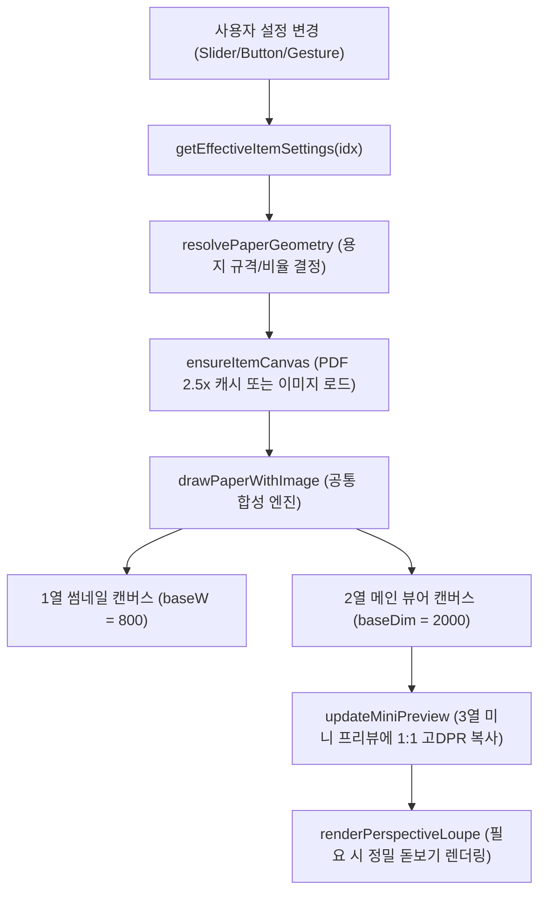

# PixPDF 시스템 아키텍처 및 메커니즘 사전 (ARCHITECTURE.md)

이 문서는 **PixPDF**의 전체 시스템 구조, 핵심 데이터 모델, 렌더링 파이프라인, 이벤트 흐름 및 주요 함수 사전을 총정리한 **청사진(Blueprint) 및 메타데이터 사전**입니다.
**코드 수정 전 반드시 이 구조도를 참조하여 관련 함수 간의 상호작용과 파이프라인을 먼저 파악한 후 작업해야 합니다.**

---

## 📌 목차
1. [시스템 개요 및 설계 철학](#1-시스템-개요-및-설계-철학)
2. [상태 관리 및 데이터 모델 (State Machine)](#2-상태-관리-및-데이터-모델-state-machine)
3. [WYSIWYG 3창 렌더링 파이프라인 (Render Pipeline)](#3-wysiwyg-3창-렌더링-파이프라인-render-pipeline)
4. [용지(Paper) vs 이미지(Image) 듀얼 변환 메커니즘](#4-용지paper-vs-이미지image-듀얼-변환-메커니즘)
5. [투시변환(Perspective Warp) 및 돋보기(Loupe) 메커니즘](#5-투시변환perspective-warp-및-돋보기loupe-메커니즘)
6. [UI 레이아웃 및 디바이스 반응형 구조](#6-ui-레이아웃-및-디바이스-반응형-구조)
7. [내보내기 및 파일 변환 엔진 (Export Engine)](#7-내보내기-및-파일-변환-엔진-export-engine)
8. [핵심 함수 사전 (Function Dictionary)](#8-핵심-함수-사전-function-dictionary)

---

## 1. 시스템 개요 및 설계 철학

- **Zero-Server & Offline-First**: 100% 브라우저 메모리(Web API, HTML5 Canvas) 내에서만 구동되며, 외부 서버 전송이 전무한 완전 무결 보안 아키텍처.
- **PWA 지원**: Service Worker(`sw.js`) 및 `manifest.json` 기반 오프라인 단독 구동.
- **WYSIWYG 3창 일체화**:
  - **1열 (좌측)**: 썸네일 리스트 (모바일 메인 열람창)
  - **2열 (중앙)**: 고해상도 메인 뷰어 (PC 메인 작업창)
  - **3열 (우측)**: 제어 패널 및 미니 프리뷰 (모바일에서는 하단 슬라이드 패널)
  - 세 화면이 `drawPaperWithImage` 단일 합성 엔진을 통해 100% 동일한 비주얼을 실시간 동기화.

---

## 2. 상태 관리 및 데이터 모델 (State Machine)

### `docState` (전역 단일 상태 트리)
```javascript
docState = {
  items: [],            // Array<Item> - 로드된 페이지/이미지 목록
  currentIndex: 0,      // Number - 현재 선택되어 편집 중인 항목의 0-based 인덱스
  checkList: [],        // Array<Boolean> - 각 항목의 선택(체크) 여부 (저장 대상)
  globalSettings: { ... } // 전역 일괄 적용 기본 설정
}
```

### `Item` 객체 구조
- **PDF 페이지**: `{ type: 'pdf', name: '문서.pdf', pageNum: 1, doc: PDFDocumentProxy, width: 595, height: 842, imgObj: offCanvas (2.5x 캐시) }`
- **일반 이미지**: `{ type: 'image', name: '사진.png', file: File, width: 2400, height: 3200, imgObj: HTMLImageElement }`

### `Settings` (페이지/이미지 개별 설정 속성)
- **용지 속성**:
  - `pageSize` / `fit`: `'original' | 'a4' | 'a3' | 'b5' | 'custom'`
  - `orient`: `'auto' | 'p' | 'l'` (세로/가로)
  - `rotPage`: 바탕 용지 90° 단위 회전 각도 (0, 90, 180, 270)
  - `margin`: 용지 내부 여백 (px 단위)
  - `transparentBg`: PNG 투명 배경 유지 여부 (`true | false`)
- **내용물(이미지) 속성**:
  - `rotImg`: 내용물 이미지 회전 각도 (-180° ~ +180°)
  - `contentScale`: 내용물 전체 확대/축소 배율 (0.2 ~ 3.0)
  - `scaleX`: 내용물 가로 폭 독립 배율 (0.5 ~ 2.0)
  - `offsetX`, `offsetY`: 용지 내 위치 이동 좌표 (px)
  - `brightness`, `contrast`: 밝기 및 대비 백분율 (0 ~ 200)
  - `corners`: 투시변환 4개 모서리 오프셋 `{ tl: {x,y}, tr: {x,y}, br: {x,y}, bl: {x,y} }`

---

## 3. WYSIWYG 3창 렌더링 파이프라인 (Render Pipeline)



### 해상도 규격 (초고해상도 유지 원칙 - ADR-001)
- **1열 썸네일 (`baseW = 800`)**: 모바일에서 문서의 작은 글자까지 또렷하게 식별.
- **2열 메인 뷰어 (`baseDim = 2000`)**: 200~300% 확대 열람 시에도 디테일 보존.
- **3열 미니 프리뷰 (`dpr >= 3.5`)**: 2열 메인 캔버스를 고해상도 백버퍼에 축약 복사.

---

## 4. 용지(Paper) vs 이미지(Image) 듀얼 변환 메커니즘

- **용지 회전 (`rotPage`)**:
  - 바탕 종이만 90° 단위로 가로/세로 비율이 전환됨.
  - 종이 위의 이미지는 스스로 회전하지 않으며 종이의 새로운 종횡비에 맞춰 재배치됨.
- **이미지 회전 (`rotImg`)**:
  - 바탕 종이는 가만히 고정되고 종이 위의 이미지만 미세 각도(0.1° 단위) 또는 90° 단위로 회전.
- **클리핑 마스킹**:
  - 용지 경계를 벗어난 이미지는 `ctx.clip()`에 의해 종이 외곽선에서 깔끔하게 절단됨.
- **배경 투명화**:
  - PNG 포맷 선택 시 투명 배경 격자(`checkerboard-bg`) 표출.
  - PDF 병합 및 JPEG 변환 시에는 검은색 오염 방지를 위해 흰색 배경으로 자동 폴백.

---

## 5. 투시변환(Perspective Warp) 및 돋보기(Loupe) 메커니즘

### 투시변환 원리
1. **변환 진입 시 뷰포트 25% 추가 축소**:
   - 용지 외곽으로 핀을 여유롭게 끌어낼 수 있도록 작업 회색 여백을 대폭 확장.
2. **사각 메쉬 분할 (Grid Subdivision Warp)**:
   - 브라우저 네이티브 2D Canvas의 아핀 변환 한계를 극복하기 위해 이미지를 NxN 개의 미세 삼각형 메쉬로 분할하여 양방향 투시 왜곡을 실시간 렌더링.
3. **경계 클램핑 (Clamp Boundary)**:
   - 핀을 회색 작업 박스 밖으로 무한정 끌어당겨 이미지가 헛돌며 찌그러지는 현상을 원천 방어.

### 정밀 돋보기 (Loupe)
- **가운데 창(`viewerPinLoupe`) & 우측 창(`miniPinLoupe`) 동시 지원**.
- **십자선 배제**: 시야를 가리는 중심 십자선은 제거(ADR-002).
- **용지 윤곽선 및 네 모서리 기준선 동시 렌더링**: 종이와 핀의 정렬 위치를 직관적으로 파악 가능.

---

## 6. UI 레이아웃 및 디바이스 반응형 구조

- **데스크톱 (화면 폭 > 860px)**:
  - 3열 그리드: `1열(280px) | 2열(1fr 유연) | 3열(320px)`
  - 중앙 뷰어 줌/패닝, 휠 제어, 상단 툴바 활성화.
- **모바일 (화면 폭 <= 860px)**:
  - 2열 메인 뷰어 숨김 (`display: none !important`).
  - **1열 썸네일 카드가 메인 작업 화면**으로 전환됨 (초고해상도 800px 필수 이유).
  - 우측 3열 편집 제어창은 필요 시 하단에서 슬라이드로 올라오는 드로어 형태로 동작.
  - **네비게이션**: 하드웨어/제스처 뒤로가기 시 프로그램적 닫기 보호 및 더블 탭 종료(ADR-009).

---

## 7. 내보내기 및 파일 변환 엔진 (Export Engine)

1. **PDF로 저장 (`exportImagesAsPdf`)**:
   - 체크된 항목들을 jsPDF 라이브러리를 통해 단일 PDF로 결합.
   - 각 페이지는 사용자가 지정한 용지 크기(A4, A3 등)와 일치하는 mm 규격으로 정확히 생성.
2. **이미지로 저장 (`exportPdfAsImages`)**:
   - 체크된 각 페이지를 설정된 포맷(PNG, JPEG, WebP 등) 및 화질로 렌더링.
   - JSZip을 통해 `page_001.png`, `page_002.png`와 같이 3자리 0-패딩 파일명으로 일괄 압축 다운로드.

---

## 8. 핵심 함수 사전 (Function Dictionary)

| 함수명 | 위치/성격 | 주요 역할 및 메커니즘 |
| :--- | :--- | :--- |
| `resolvePaperGeometry` | 용지 기하 연산 | 선택된 규격(A4 등)과 방향에 따른 가로/세로 픽셀 및 종횡비 계산 |
| `ensureItemCanvas` | 리소스 로더 | PDF 페이지를 2.5x 고해상도 오프스크린 캔버스로 렌더링하여 캐싱 |
| `drawPaperWithImage` | **마스터 렌더러** | 바탕 용지 위에 여백, 회전, 스케일, 위치, 투시변환을 합성 렌더링 |
| `renderThumbnailList` | 1열 관리 | 좌측 썸네일 카드 목록 생성 및 800px 고화질 렌더링 트리거 |
| `updateThumbnailCanvas`| 1열 단일 갱신 | 특정 인덱스의 썸네일 카드 캔버스만 즉시 다시 그리기 |
| `loadMainViewer` | 2열 관리 | 선택된 인덱스를 2열 메인 뷰어에 로드하고 줌/인디케이터 동기화 |
| `renderMainViewerCanvas`| 2열 렌더러 | 2열 메인 캔버스에 2000px 초고해상도로 합성 렌더링 |
| `updateMiniPreview` | 3열 프리뷰 | 2열 캔버스를 3열 미니 시트에 정률 복사하고 실시간 편집 메타 표출 |
| `updateCornerPins` | 투시변환 | 현재 활성 창(메인 뷰어 또는 미니 시트)의 4개 코너 핀 위치 계산 및 갱신 |
| `updateMiniPinLoupe` | 돋보기 엔진 | 미니 프리뷰 핀 조작 시 용지 경계와 이미지를 확대한 돋보기 표출 |
| `updateViewerPinLoupe` | 돋보기 엔진 | 메인 뷰어 핀 조작 시 용지 경계와 이미지를 확대한 돋보기 표출 |
| `applyZoom` | 뷰어 네비게이션 | 2열 메인 뷰어 확대/축소 배율 적용 및 배지 텍스트 갱신 |
| `handleDropFiles` | 파일 수집 | 드래그 앤 드롭 또는 파일 선택창으로부터 PDF/이미지 파싱 |
| `exportImagesAsPdf` | 출력 엔진 | 다중 페이지 합성 캔버스를 단일 PDF 파일로 직렬화하여 저장 |
| `exportPdfAsImages` | 출력 엔진 | 합성 캔버스들을 개별 이미지로 변환 후 ZIP 압축 다운로드 |
