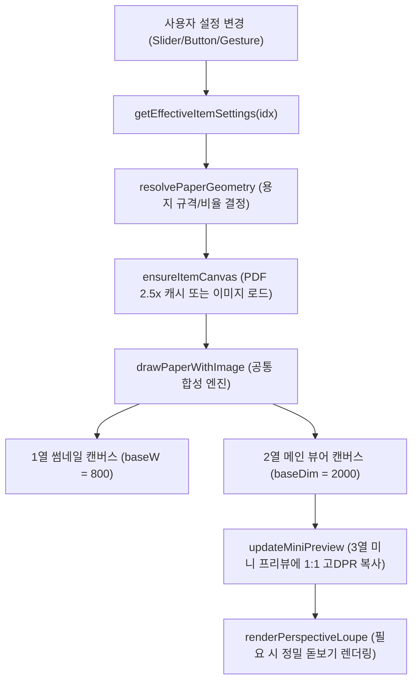

# PixPDF 시스템 아키텍처 및 메커니즘 사전 (ARCHITECTURE.md)

이 문서는 **PixPDF**의 전체 시스템 구조, 핵심 데이터 모델, 렌더링 파이프라인, 이벤트 흐름 및 주요 함수 사전을 총정리한 **청사진(Blueprint) 및 메타데이터 사전**입니다.
**코드 수정 전 반드시 이 구조도를 참조하여 관련 함수 간의 상호작용과 파이프라인을 먼저 파악한 후 작업해야 합니다.**

---

## 📌 목차
1. [시스템 개요 및 설계 철학](#1-시스템-개요-및-설계-철학)
2. [상태 관리 및 데이터 모델 (State Machine)](#2-상태-관리-및-데이터-모델-state-machine)
3. [WYSIWYG 3창 렌더링 파이프라인 (Render Pipeline)](#3-wysiwyg-3창-렌더링-파이프라인-render-pipeline)
4. [용지(Paper) vs 이미지(Image) 듀얼 변환 메커니즘](#4-용지paper-vs-이미지image-듀얼-변환-메커니즘)
5. [투시변환(Perspective Warp) 및 돋보기(Loupe) 메커니즘](#5-투시변환perspective-warp-및-돋보기loupe-메커니즘)
6. [UI 레이아웃 및 디바이스 반응형 구조](#6-ui-레이아웃-및-디바이스-반응형-구조)
7. [내보내기 및 파일 변환 엔진 (Export Engine)](#7-내보내기-및-파일-변환-엔진-export-engine)
8. [핵심 함수 사전 (Function Dictionary)](#8-핵심-함수-사전-function-dictionary)

---

## 1. 시스템 개요 및 설계 철학

- **Zero-Server & Offline-First**: 100% 브라우저 메모리(Web API, HTML5 Canvas) 내에서만 구동되며, 외부 서버 전송이 전무한 완전 무결 보안 아키텍처.
- **PWA 지원**: Service Worker(`sw.js`) 및 `manifest.json` 기반 오프라인 단독 구동.
- **WYSIWYG 3창 일체화**:
  - **1열 (좌측)**: 썸네일 리스트 (모바일 메인 열람창)
  - **2열 (중앙)**: 고해상도 메인 뷰어 (PC 메인 작업창)
  - **3열 (우측)**: 제어 패널 및 미니 프리뷰 (모바일에서는 하단 슬라이드 패널)
  - 세 화면이 `drawPaperWithImage` 단일 합성 엔진을 통해 100% 동일한 비주얼을 실시간 동기화.

---

## 2. 상태 관리 및 데이터 모델 (State Machine)

### `docState` (전역 단일 상태 트리)
```javascript
docState = {
  items: [],            // Array<Item> - 로드된 페이지/이미지 목록
  currentIndex: 0,      // Number - 현재 선택되어 편집 중인 항목의 0-based 인덱스
  checkList: [],        // Array<Boolean> - 각 항목의 선택(체크) 여부 (저장 대상)
  globalSettings: { ... } // 전역 일괄 적용 기본 설정
}
```

### `Item` 객체 구조
- **PDF 페이지**: `{ type: 'pdf', name: '문서.pdf', pageNum: 1, doc: PDFDocumentProxy, width: 595, height: 842, imgObj: offCanvas (2.5x 캐시) }`
- **일반 이미지**: `{ type: 'image', name: '사진.png', file: File, width: 2400, height: 3200, imgObj: HTMLImageElement }`

### `Settings` (페이지/이미지 개별 설정 속성)
- **용지 속성**:
  - `pageSize` / `fit`: `'original' | 'a4' | 'a3' | 'b5' | 'custom'`
  - `orient`: `'auto' | 'p' | 'l'` (세로/가로)
  - `rotPage`: 바탕 용지 90° 단위 회전 각도 (0, 90, 180, 270)
  - `margin`: 용지 내부 여백 (px 단위)
  - `transparentBg`: PNG 투명 배경 유지 여부 (`true | false`)
- **내용물(이미지) 속성**:
  - `rotImg`: 내용물 이미지 회전 각도 (-180° ~ +180°)
  - `contentScale`: 내용물 전체 확대/축소 배율 (0.2 ~ 3.0)
  - `scaleX`: 내용물 가로 폭 독립 배율 (0.5 ~ 2.0)
  - `offsetX`, `offsetY`: 용지 내 위치 이동 좌표 (px)
  - `brightness`, `contrast`: 밝기 및 대비 백분율 (0 ~ 200)
  - `corners`: 투시변환 4개 모서리 오프셋 `{ tl: {x,y}, tr: {x,y}, br: {x,y}, bl: {x,y} }`

---

## 3. WYSIWYG 3창 렌더링 파이프라인 (Render Pipeline)



### 해상도 규격 (초고해상도 유지 원칙 - ADR-001, ADR-025)
- **1열 썸네일 (`baseW = 800`)**: 모바일에서는 1열 카드가 문서의 실제 글자를 읽고 검토하는 핵심 화면이므로, 최소 `baseW = 800`의 초고해상도를 유지하며 임의 다운샘플링을 엄격 금지함.
- **2열 메인 뷰어 (`baseDim = 2000`)**: 기준 해상도 `baseDim = 2000`을 유지하여 200~300% 확대 열람 시에도 디테일과 선명도를 완벽 보존.
- **3열 미니 프리뷰 (`dpr >= 3.5`)**: 2열 메인 캔버스를 고해상도 백버퍼에 축약 복사하여 브라우저 자체 확대 열람 시에도 자르기/투시변환 결과를 선명하게 파악 가능.

---

## 4. 용지(Paper) vs 이미지(Image) 듀얼 변환 메커니즘

### 용지(Paper Stage) vs 객체(Object Layer) 분리 아키텍처 (ADR-025)
- **용지 (바탕 종이 / Paper Stage)**:
  - 최종 출력/PDF 저장/Img 저장/인쇄의 기준이 되는 바탕 캔버스 (A4, A3, B5, 사용자 지정, 원본 등).
  - 향후 한 페이지에 여러 이미지를 배치하거나 콜라주, 글상자, 도형을 추가하기 위한 부동의 스테이지.
  - **용지 회전 (`rotPage`)**: 바탕 종이 자체를 90° 단위로 가로/세로 비율만 회전하며, 종이 위의 이미지는 스스로 회전하지 않고 종이의 새 종횡비에 맞춰 재배치됨.
  - 여백(Margin)과 배경색(흰색 또는 투명 격자)은 용지 자체의 속성.
- **객체 (내용물 / Image Object Layer)**:
  - 용지 위에 배치되는 실제 PDF/이미지 래스터 그래픽 데이터.
  - **이미지 회전 (`rotImg`)**: 용지는 가만히 두고 용지 위의 이미지만 미세 각도(0.1° 단위) 또는 90° 단위로 회전.
  - 크기(Scale), 가로 배율(ScaleX), 위치 이동(Offset X/Y), 밝기/대비, 투시변환(Corners)은 객체 내용물의 속성.

### 자르기(Crop) 모드 분리 메커니즘
1. **객체 자르기 (`cropPaper = false`)**:
   - 용지는 100% 원래 규격(A4, B5, 또는 원본 전체 크기)을 고정 유지.
   - 용지 위에서 객체(이미지)만 지정된 크롭 영역으로 절단되어 본래의 배치 위치와 배율을 유지 (`ctx.rect(); ctx.clip()`).
   - 잘린 이미지 바깥의 용지 영역은 본래의 용지 배경(흰색 또는 투명 격자)으로 보존됨.
   - **출력/PDF 저장/Img 저장/인쇄**: 남은 여백을 포함하여 **용지 전체 규격 그대로 WYSIWYG 출력**.
2. **종이 연동 자르기 (`cropPaper = true`)**:
   - 잘라낸 객체 영역에 맞춰 바탕 종이 자체도 함께 잘려 나감 (`paperW = effDims.width, paperH = effDims.height`).
   - **PDF/이미지 저장**: 주변 불필요한 용지 여백 없이 **잘린 이미지 사각형 그대로 직결 저장**.
   - **인쇄**: 출력 장치 특성상 지정 용지 한 장의 중앙에 잘린 이미지가 배치되어 인쇄.

### 클리핑 및 투명도 안전장치
- **클리핑 마스킹**: 용지 경계를 벗어난 이미지는 `ctx.clip()`에 의해 종이 외곽선에서 깔끔하게 절단됨.
- **배경 투명화 및 검은색 오염 방지**:
  - PNG 포맷 선택 시 투명 배경 격자(`checkerboard-bg`) 표출.
  - PDF 병합 및 JPEG 변환 시에는 투명 영역이 검은색(Black)으로 오염되는 현상을 방지하기 위해 흰색 배경으로 자동 폴백 채우기 선행.

---

## 5. 투시변환(Perspective Warp) 및 돋보기(Loupe) 메커니즘

### 투시변환 원리
1. **변환 진입 시 뷰포트 25% 추가 축소**:
   - 용지 외곽으로 핀을 여유롭게 끌어낼 수 있도록 작업 회색 여백을 대폭 확장.
2. **사각 메쉬 분할 (Grid Subdivision Warp)**:
   - 브라우저 네이티브 2D Canvas의 아핀 변환 한계를 극복하기 위해 이미지를 NxN 개의 미세 삼각형 메쉬로 분할하여 양방향 투시 왜곡을 실시간 렌더링.
3. **경계 클램핑 (Clamp Boundary)**:
   - 핀을 회색 작업 박스 밖으로 무한정 끌어당겨 이미지가 헛돌며 찌그러지는 현상을 원천 방어.

### 정밀 돋보기 (Loupe)
- **가운데 창(`viewerPinLoupe`) & 우측 창(`miniPinLoupe`) 동시 지원**.
- **십자선 배제**: 시야를 가리는 중심 십자선은 제거(ADR-002).
- **용지 윤곽선 및 네 모서리 기준선 동시 렌더링**: 종이와 핀의 정렬 위치를 직관적으로 파악 가능.

---

## 6. UI 레이아웃 및 디바이스 반응형 구조

- **데스크톱 (화면 폭 > 860px)**:
  - 3열 그리드: `1열(280px) | 2열(1fr 유연) | 3열(320px)`
  - 중앙 뷰어 줌/패닝, 휠 제어, 상단 툴바 활성화.
- **모바일 (화면 폭 <= 860px)**:
  - 2열 메인 뷰어 숨김 (`display: none !important`).
  - **1열 썸네일 카드가 메인 작업 화면**으로 전환됨 (초고해상도 800px 필수 이유).
  - 우측 3열 편집 제어창은 필요 시 하단에서 슬라이드로 올라오는 드로어 형태로 동작.
  - **네비게이션**: 하드웨어/제스처 뒤로가기 시 프로그램적 닫기 보호 및 더블 탭 종료(ADR-009).

---

## 7. 내보내기 및 파일 변환 엔진 (Export Engine)

1. **PDF로 저장 (`exportImagesAsPdf`)**:
   - 체크된 항목들을 jsPDF 라이브러리를 통해 단일 PDF로 결합.
   - 각 페이지는 사용자가 지정한 용지 크기(A4, A3 등)와 일치하는 mm 규격으로 정확히 생성.
2. **이미지로 저장 (`exportPdfAsImages`)**:
   - 체크된 각 페이지를 설정된 포맷(PNG, JPEG, WebP 등) 및 화질로 렌더링.
   - JSZip을 통해 `page_001.png`, `page_002.png`와 같이 3자리 0-패딩 파일명으로 일괄 압축 다운로드.
3. **인쇄 및 인쇄창 PDF 저장 (`triggerPrint` - ADR-026)**:
   - `@page`는 항상 원래 용지 크기·방향(ADR-027). 종이 연동 결과물은 원래 용지 중앙에 실제 크기로 배치되어 프린터가 용지를 눕히지 않음.
4. **실제 축척 헬퍼 (`getOutputPaperScale` - ADR-027)**:
   - 화면 표시·인쇄·앱 PDF 저장 모두 '원래 용지' 기준 `mmPerPx`/`imgFit`을 공유. 앱 PDF는 `unit: 'mm'`으로 실제 크기 기록(A4 → 210×297mm).
   - 화면(1·2·3열)에서 종이 연동 페이지는 원래 용지 축척으로 작게 표시(잘려 나간 영역은 연회색).

---

## 8. 핵심 함수 사전 (Function Dictionary)

| 함수명 | 모듈 파일 (`src/js/`) | 주요 역할 및 메커니즘 |
| :--- | :--- | :--- |
| `resolvePaperGeometry` | `01_state.js` | 선택된 규격(A4 등)과 방향에 따른 가로/세로 픽셀 및 종횡비 계산 |
| `getImageOffsetMaxLimits`| `02_transform.js` | 마지막 1픽셀 접촉 한계 기준 이미지 최대 이동 허용 오프셋(%) 계산 |
| `drawPerspectiveQuad` | `02_transform.js` | 삼각형 메쉬 분할 기반의 4개 코너 투시 왜곡 실시간 렌더링 |
| `ensureItemCanvas` | `03_render.js` | PDF 페이지를 2.5x 고해상도 오프스크린 캔버스로 렌더링하여 캐싱 |
| `drawPaperWithImage` | `03_render.js` | 바탕 용지 위에 여백, 회전, 스케일, 위치, 투시변환을 합성 렌더링 (**마스터 렌더러**) |
| `updateThumbnailCanvas`| `03_render.js` | 특정 인덱스의 썸네일 카드 캔버스만 즉시 다시 그리기 |
| `renderThumbnailList` | `04_file_mgr.js` | 좌측 썸네일 카드 목록 생성 및 800px 고화질 렌더링 트리거 |
| `processFiles` | `04_file_mgr.js` | 드래그 앤 드롭 또는 파일 선택창으로부터 PDF/이미지 파싱 |
| `openPdfPicker` | `04_file_mgr.js` | PDF 낱장/범위 선택 모달 표출 및 삽입 처리 |
| `renderMainViewerCanvas`| `05_viewer.js` | 2열 메인 캔버스에 2000px 초고해상도로 합성 렌더링 |
| `loadMainViewer` | `05_viewer.js` | 선택된 인덱스를 2열 메인 뷰어에 로드하고 줌/인디케이터 동기화 |
| `applyZoom` | `05_viewer.js` | 2열 메인 뷰어 확대/축소 배율 적용 및 배지 텍스트 갱신 |
| `updateCornerPins` | `06_perspective_loupe.js` | 현재 활성 창(메인 뷰어 또는 미니 시트)의 4개 코너 핀 위치 계산 및 갱신 |
| `updateMiniPinLoupe` | `06_perspective_loupe.js` | 미니 프리뷰 핀 조작 시 용지 경계와 이미지를 확대한 돋보기 표출 |
| `updateViewerPinLoupe` | `06_perspective_loupe.js` | 메인 뷰어 핀 조작 시 용지 경계와 이미지를 확대한 돋보기 표출 |
| `updateMiniPreview` | `06_perspective_loupe.js` | 2열 캔버스를 3열 미니 시트에 정률 복사하고 실시간 편집 메타 표출 |
| `executeActionSave` | `07_export.js` | 체크된 항목들을 단일 PDF 또는 ZIP 분할 이미지로 분기 저장 |
| `executeSaveMergedPdf` | `07_export.js` | 다중 페이지 합성 캔버스를 단일 PDF 파일로 직렬화하여 저장 |
| `executeSaveSplitImages` | `07_export.js` | 합성 캔버스들을 개별 이미지로 변환 후 ZIP 압축 다운로드 |
| `armUserGestureHistory` | `04_file_mgr.js` | 첫 터치/클릭 제스처 시 크로미움 뒤로가기 가로채기 앵커 무장 |
| `showExitToast` | `04_file_mgr.js` | 메인 화면 뒤로가기 1회차 시 2초 카운트다운 더블 탭 종료 토스트 표출 |

---

## 9. 모듈식 소스 디렉터리 구조 (`src/`) 및 원클릭 빌더

- `src/template.html`: 공통 HTML 골격 및 메타 태그
- `src/css/style.css`: 전체 앱 스타일시트 (1800라인)
- `src/js/` (8대 기능별 JS 모듈):
  - `01_state.js`: 전역 상태(`docState`), PWA 등록, 용지 규격 상수(`PAPER_SPECS`)
  - `02_transform.js`: 회전 연산, 사각/사다리꼴 투시변환 수식
  - `03_render.js`: `drawPaperWithImage`, PDF 2.5x 렌더러, 썸네일 합성
  - `04_file_mgr.js`: 파일 로더, PDF 페이지 선택기, 드래그&드롭, 썸네일 리스트
  - `05_viewer.js`: 2열 메인 뷰어 제어, 줌 네비게이션, 필터 조절
  - `06_perspective_loupe.js`: 4코너 핀 제어, 정밀 돋보기(Loupe), 3열 미니 프리뷰
  - `07_export.js`: PDF/ZIP 저장 엔진 및 바이너리 인코더
  - `08_events.js`: 휠 줌/스크롤, 터치 패닝, 뒤로가기 더블 탭 종료
- `build.ps1` / `build.bat`:
  - 1초 만에 `src/`의 모든 모듈을 단일 독립 파일(`pixpdf.html` / `index.html`)로 병합.
  - 회사업무용 오프라인 환경에서 단일 파일만 복사해가면 더블 클릭으로 100% 정상 구동 보장.
